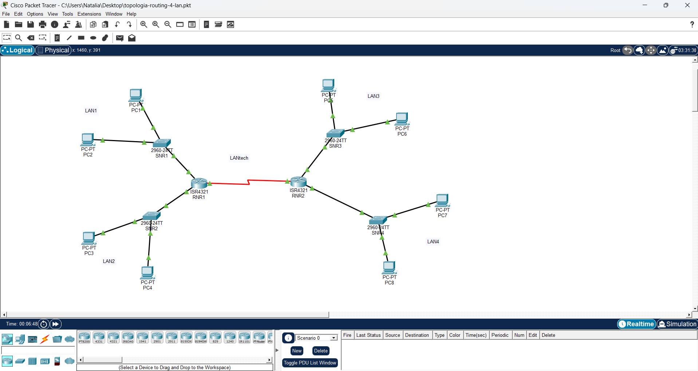

# Projekt sieci firmowej z podziałem VLSM i routingiem (Cisco Packet Tracer)

Projekt i konfiguracja sieci komputerowej łączącej cztery podsieci działowe (`LAN1`–`LAN4`) oraz łącze punkt-punkt między routerami (`LANtech`), wydzielone z puli adresowej `10.10.X.0/24` za pomocą maski o zmiennej długości (**VLSM**).

## Podział na podsieci (VLSM)
Sieć bazowa `/24` została podzielona optymalnie pod kątem zapotrzebowania na hosty (od największej do najmniejszej podsieci):
* **`LAN1`** (min. 100 hostów) – maska `/25` (`255.255.255.128`, do 126 hostów).
* **`LAN3`** (min. 50 hostów) – maska `/26` (`255.255.255.192`, do 62 hostów).
* **`LAN2`** (min. 10 hostów) – maska `/28` (`255.255.255.240`, do 14 hostów).
* **`LAN4`** (min. 5 hostów) – maska `/29` (`255.255.255.248`, do 6 hostów).
* **`LANtech`** (połączenie między routerami, 2 hosty) – maska `/30` (`255.255.255.252`, 2 użyteczne adresy IP).

## Standard adresacji i konfiguracja urządzeń
* **Bramy domyślne (interfejsy routerów):** Pierwszy użyteczny adres IP w każdej podsieci.
* **Przełączniki (zarządzanie SVI / VLAN 1):** Ostatni użyteczny adres IP w danej podsieci wraz ze skonfigurowaną bramą domyślną (`ip default-gateway`).
* **Stacje robocze (`PC1`–`PC8`):** Drugi i trzeci adres IP w przypisanej podsieci.
* **Zabezpieczenia i administracja (Cisco IOS):**
  * Ujednolicone nazewnictwo urządzeń aktywnych (`RNR1`, `RNR2`, `SNR1`–`SNR4`).
  * Konfiguracja haseł dostępu do konsoli (`line con 0`), terminali wirtualnych VTY (`line vty 0 4`) oraz trybu uprzywilejowanego (`enable secret`).
  * Komunikaty ostrzegawcze (`banner motd`) na każdym routerze i przełączniku.
  * Routing statyczny zapewniający pełną komunikację (ICMP `ping`) między wszystkimi 4 podsieciami.

## Zawartość katalogu
* `topologia-routing-4-lan.pkt` – zapisana topologia oraz konfiguracja urządzeń do uruchomienia w Cisco Packet Tracer.
* `schemat-sieci.png` – diagram logiczny sieci.
